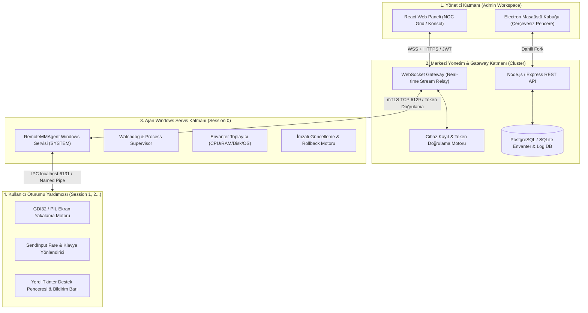

# RemoteMM Enterprise — Ticari Ürün ve Kurumsal Dağıtım Master Planı
**Sürüm:** 1.0.0-PRO  
**Tarih:** 19 Ekim 2026  
**Hedef Kitle:** Kurumsal BT Departmanları, MSP (Yönetilen Hizmet Sağlayıcıları), Bilgi Güvenliği Ekipleri (CISO)  
**Regülasyon Hedefleri:** KVKK, GDPR, ISO/IEC 27001, SOC 2 Type II  

---

## 1. YÖNETİCİ ÖZETİ VE ÜRÜN VİZYONU

### 1.1 Ürün Tanımı
RemoteMM Enterprise; kurum içi ağlarda veya bulut altyapısında barındırılan, binlerce Windows istemci ve sunucusunu tek bir merkezi ekrandan gerçek zamanlı izleyen (NOC), uzaktan yöneten, canlı destek sunan ve tüm operasyonları silinemez denetim izleriyle (Audit Trail) kayıt altına alan ticari bir **RMM (Remote Monitoring & Management)** platformudur.

### 1.2 Ürünün Ticari Konumlandırması
RemoteMM sıradan bir P2P uzak masaüstü aracı (TeamViewer, AnyDesk) değil; **MeshCentral'ın merkezi cihaz ve yönetim gücünü, RustDesk'in akıcı görüntü aktarım performansını** bir araya getiren kurumsal bir sistem yönetim suite'idir.

```
+-----------------------------------------------------------------------------------+
|                           RemoteMM ENTERPRISE SUITE                               |
+-------------------------+-------------------------------+-------------------------+
|     NOC & İZLEME        |       UZAKTAN DESTEK          |     SİSTEM OPERASYONU   |
| • Filo Sağlık Matrisi   | • Düşük Gecikmeli Ekran Akışı | • Donanım/Yazılım Envanter|
| • Anlık Snapshot Grid   | • UAC & Secure Desktop Geçişi | • Arka Plan Süreç Yönetimi|
| • Donanım Eşik Uyarıları| • Çift Yönlü Ops Sohbet & Zil | • Yetkili Dosya Gezgini |
| • Canlı Heartbeat Ağı   | • Şeffaf Oturum Çubuğu        | • WoL & Uzaktan Güç Ynt.|
+-------------------------+-------------------------------+-------------------------+
|             GÜVENLİK, UYUMLULUK VE DENETİM (TEMEL ÇEKİRDEK)                       |
| • Multi-Tenant İzolasyonu  • mTLS & Cihaz Tokenları  • Tahrif Edilemez Audit Log  |
+-----------------------------------------------------------------------------------+
```

---

## 2. DÖRT KATMANLI HEDEF MİMARİ

Sistem dört ana katmandan oluşur. Bu katmanlar arasındaki sınırlar kesin ve şifrelidir:



---

## 3. KURUMSAL GÜVENLİK VE UYUMLULUK STANDARTLARI

Ticari bir şirkete satılacak bir yazılımda aşağıdaki kurallar tavizsiz uygulanır:

### 3.1 Cihaz Kimliği ve Karşılıklı Doğrulama (Device Identity & mTLS)
* Her ajan ilk kurulduğunda donanım parametrelerinden (CPU ID, BIOS UUID, Anakart Seri No, Birincil MAC) türetilen tekil bir **Hardware Fingerprint** oluşturur.
* Sunucu bu cihaza benzersiz bir `Device UUID` ve kriptografik bir `Device Secret / Token` atar.
* Cihaz sunucuya bağlanırken bu token doğrulanır. Ağda aynı IP'yi kullanan sahte/klonlanmış cihazlar anında engellenir.
* Yönetici panelinden tek tıkla herhangi bir cihazın erişim anahtarı iptal edilebilir (Revocation).

### 3.2 Tahrif Edilemez Denetim İzi (Tamper-Proof Audit Logging)
* Sistemde gerçekleşen her eylem yapılandırılmış JSON formatında saklanır:
  ```json
  {
    "timestamp": "2026-10-19T22:30:00.000Z",
    "event_id": "evt_9f83a2",
    "tenant_id": "tenant_acme_corp",
    "operator": "ahmet.yilmaz@acme.com",
    "operator_ip": "192.168.1.50",
    "target_device_id": "dev_win11_muhasebe_04",
    "target_ip": "10.0.5.12",
    "action": "REMOTE_DESKTOP_CONNECT",
    "mode": "FULL_CONTROL",
    "session_duration_sec": 420,
    "result": "SUCCESS",
    "details": { "screen_resolution": "1920x1080", "files_transferred": 0 }
  }
  ```
* Loglarda hiçbir zaman açık parola, gizli anahtar veya kullanıcı özel verisi yer almaz.

### 3.3 Şeffaf Oturum ve Kullanıcı Rızası (Consent & Transparency)
* Gizli izleme veya casus yazılım fonksiyonları temel kurumsal sürümde yer almaz.
* Bağlantı kurulduğunda kullanıcının ekranının sağ altında *"IT Destek Oturumu Aktif — Teknisyen: [İsim]"* ibaresi bulunan şık, kapatılamaz bir oturum çubuğu yer alır.
* Kurum politikasına göre (Örn: KVKK modu aktifse), teknisyen bağlanmak istediğinde karşı tarafa *"Teknisyen bilgisayarınıza bağlanmak istiyor. İzin veriyor musunuz? [Kabul Et] / [Reddet]"* onay modalı düşer.

---

## 4. DETAYLI GELİŞTİRME FAZLARI (FAZ 0 - FAZ 5)

```
GELİŞTİRME ZAMAN ÇİZELGESİ (ROADMAP)
┌─────────────────┐   ┌─────────────────┐   ┌─────────────────┐   ┌─────────────────┐   ┌─────────────────┐
│ FAZ 0: Keşif &  │──>│ FAZ 1: Güvenlik │──>│ FAZ 2: NOC Grid │──>│ FAZ 3: Canlı    │──>│ FAZ 4: Sistem   │──> [FAZ 5: Dağıtım]
│ Kararlılık (P0) │   │ Çekirdeği (RBAC)│   │ & Ölçekleme     │   │ Destek Motoru   │   │ Operasyonları   │
└─────────────────┘   └─────────────────┘   └─────────────────┘   └─────────────────┘   └─────────────────┘
```

---

### FAZ 0: Mevcut Kod Tabanı Kararlılığı ve Test Temeli (Tamamlandı)
* **Hedef:** Mevcut React + Node Gateway + Python Ajan kodunun haritasını çıkarmak, belgelendirmek ve test altyapısını kurmak.
* **Uygulananlar:**
  * `docs/CURRENT_STATE.md` oluşturuldu.
  * Açık bağlantı durum makinesi (`disconnected` -> `connecting` -> `connected` -> `reconnecting` -> `error`) entegre edildi.
  * Kademeli artan beklemeli (exponential backoff) otomatik yeniden bağlanma algoritması yazıldı.
  * `tests/test_agent_protocol.py` (7 birim testi) ve `tests/test_gateway_state.mjs` (3 durum testi) yazılıp başarıyla koşuldu.
  * `docs/TEST_REPORT.md` oluşturuldu.

---

### FAZ 1: Güvenli Çekirdek, Cihaz Kaydı ve RBAC
* **Hedef:** Sisteme giriş yapan operatörlerin yetkilendirilmesi ve yönetilen cihazların benzersiz kimliklerle sunucuya bağlanması.
* **Alt Görevler:**
  1. **Cihaz Kimlik Üreticisi (`agent/identity.py`):**
     - WMI ve Registry üzerinden CPU ID, UUID ve MAC adresini toplayıp benzersiz `Device_HWID` üreten modül.
     - Cihaz anahtarını güvenli Windows DPAPI / Registry alanında saklama (`HKLM\SOFTWARE\RemoteMM\Identity`).
  2. **Merkezi Cihaz Kayıt Motoru (`server/registry.js`):**
     - İlk kez bağlanan cihazı "Onay Bekleyenler (Pending Approval)" havuzuna alma veya önceden paylaşılan şirket anahtarıyla (Enrollment Key) otomatik kaydetme.
     - Çevrim içi/çevrim dışı durumunu hafif UDP/TCP Heartbeat (her 10 sn) ile takip etme.
  3. **Rol Tabanlı Yetkilendirme (RBAC):**
     - `Admin`: Tüm yetkiler (Dağıtım, Güç, Süreç, Dosya, Canlı Konsol).
     - `Technician`: Canlı Konsol, Sohbet, Yeniden Başlatma.
     - `Auditor`: Yalnızca İzleme (View-Only) ve Denetim Kayıtlarını İnceleme.
  4. **Denetim Servisi (`server/audit.js`):**
     - Dosya ve veritabanı tabanlı, silinemez operasyon günlüğü tutma.

---

### FAZ 2: NOC Grid ve Ölçeklenebilir Filo İzleme
* **Hedef:** 50-1000 arası cihazın bulunduğu ağlarda sunucu ve ağ bant genişliğini tıkamadan anlık izleme sunmak.
* **Alt Görevler:**
  1. **İki Aşamalı Akış Stratejisi:**
     - **Grid Modu:** Cihaz başına saniyede 60 kare video yerine, 8-15 saniyede bir sıkıştırılmış hafif JPEG snapshot (küçük resim).
     - **Konsol Modu:** Yalnızca seçili makine tıklandığında devreye giren yüksek kare hızlı video akışı.
  2. **Statik Envanter Önbelleği:**
     - RAM, CPU modeli, disk boyutu gibi nadir değişen verileri her bağlantıda tekrar tekrar sormak yerine saatlik önbellekte tutma.
     - Yalnızca anlık CPU % ve RAM % kullanımını dinamik güncelleme.
  3. **Gruplama, Etiketleme ve Hızlı Filtre:**
     - Departman (Muhasebe, IT, Fabrika) ve Şube (Merkez, Ankara Şube) bazlı hiyerarşik filtreleme.
     - Arama kutusundan IP, kullanıcı adı, hostname veya işletim sistemine göre anında canlı filtreleme.
  4. **Kritik Eşik Uyarıları (Health Alerts):**
     - Disk doluluğu %90'ı aşan veya RAM kullanımı sürekli %95 olan cihazlarda sarı/kırmızı uyarı rozeti çıkarma.

---

### FAZ 3: Canlı Uzaktan Destek ve Oturum Yönetimi
* **Hedef:** Kararlı, ölçülebilir gecikmeye sahip, kilit ekranı ve UAC geçişlerinde kopmayan canlı oturum motoru.
* **Alt Görevler:**
  1. **Servis (Session 0) ve Masaüstü (Session > 0) Ayrımı:**
     - Servis arka planda SYSTEM yetkisiyle bekler; oturum açıldığında kullanıcının masaüstüne ekran yakalama işçisini (`RemoteMM_Agent.exe --session-worker`) enjekte eder.
     - Kullanıcı masaüstü kilitlendiğinde (`LockWorkstation`), işçi otomatik olarak güvenli `Winlogon` masaüstüne geçer.
  2. **Giriş Yönlendirme ve Odak Yönetimi:**
     - Fare tıklamaları ve koordinat eşleştirmesinde DPI farklarını (`SetProcessDPIAware`) hesaba katan ölçekleme.
     - Ekran oranını koruyan (Fit Aspect Ratio) matematiksel koordinat dönüştürücü.
  3. **Şeffaf Kullanıcı Arayüzü:**
     - Kullanıcı ekranında şık, rahatsız etmeyen oturum bilgilendirme çubuğu.
     - Çift yönlü sohbet penceresi ve dikkat çekme zili entegrasyonu.

---

### FAZ 4: Sistem Operasyonları ve Güvenli Dosya Transferi
* **Hedef:** Kullanıcıyı rahatsız etmeden arka planda servis, süreç ve dosya operasyonlarını gerçekleştirmek.
* **Alt Görevler:**
  1. **Parametrik Komut Sözleşmesi (Allowlist):**
     - Shell enjeksiyonu riskini önlemek için komut satırına rastgele string gönderme engellenir.
     - Tanımlı eylemler: `ACTION_REBOOT`, `ACTION_SHUTDOWN`, `ACTION_KILL_PID(pid)`, `ACTION_SERVICE_RESTART(svc_name)`.
  2. **Güvenli Dosya Yöneticisi:**
     - 25MB parça (chunk) aktarım limiti.
     - SHA-256 sağlama toplamı doğrulaması.
     - Sistem kök dizinlerini (`Windows\System32`) yetkisiz üzerine yazmalara karşı koruyan hedef filtreleri.
  3. **Uzaktan Güç Yönetimi (WoL):**
     - Hedef makinenin MAC adresine UDP 7 ve 9 üzerinden Magic Packet basan yerel ağ yayıncısı (Broadcast WoL).

---

### FAZ 5: Kurumsal Dağıtım ve Ticari Paketleme (MSI & Installer)
* **Hedef:** IT yöneticisinin Active Directory veya tek satırlık script ile 500 bilgisayara 5 dakikada ajanı kurabilmesi.
* **Alt Görevler:**
  1. **Sessiz Kurulum Destekli MSI / Exe Paketi:**
     - `msiexec /i RemoteMM_Agent.msi /quiet TENANT_ID=xxx ENROLL_TOKEN=yyy SERVER=https://noc.sirket.com`
  2. **Otomatik İyileşen Windows Servisi (Self-Healing Watchdog):**
     - Servis çökerse Windows SCM tarafından 5 saniye içinde otomatik yeniden başlatılma ayarı (`sc failure RemoteMMAgent reset= 0 actions= restart/5000`).
  3. **Güvenli Kendini Güncelleme (Auto-Updater with Rollback):**
     - Sunucuda yeni ajan sürümü olduğunda ajanın bunu SHA-256 hash ile indirip doğrulaması.
     - Kurulum başarısız olursa otomatik eski binary'ye geri dönme (Rollback).

---

## 5. TİCARİLEŞTİRME VE LİSANSLAMA MODELİ

Platformun kurumsal bir şirket çatısı altında faturalandırılması için 3 temel model sunulur:

| Paket Türü | Hedef Kitle | Fiyatlandırma Modeli | Öne Çıkan Özellikler |
|---|---|---|---|
| **SaaS Cloud (KOBİ / Startup)** | 10 - 250 Bilgisayar | Uç Nokta Başına Aylık ($1.5 - $2 / Cihaz / Ay) | Bulut Gateway, Anında Kurulum, 30 Günlük Log Geçmişi |
| **MSP Pro (BT Şirketleri)** | 250 - 5.000 Bilgisayar | Eşzamanlı Teknisyen Başına ($35 - $49 / Teknisyen / Ay) | Multi-Tenant (Müşteri Ayrımı), White-Label (Kendi Logosu), API Erişimi |
| **Enterprise On-Premise** | 1.000+ Cihaz (Banka, Kamu, Hastane) | Yıllık Kurumsal Lisans (Perpetual / Annual) | Tam Kurum İçi İzolasyon, PostgreSQL Desteği, mTLS, Sınırsız Cihaz, Active Directory Entegrasyonu |

---

## 6. HER AŞAMADA DOKÜMANTASYON VE KALİTE GÜVENCESİ
Bu master plan çerçevesinde yapılan her geliştirme turunda:
1. İlgili modülün unit ve entegrasyon testleri `tests/` klasörüne eklenir ve fiilen çalıştırılır.
2. Gerçekleşen test sonuçları `docs/TEST_REPORT.md` içine işlenir.
3. Mimari ve özellik durumu `docs/CURRENT_STATE.md` dokümanında güncellenir.
4. Hiçbir özellik test edilip doğrulanmadan "tamamlandı" olarak işaretlenmez.
